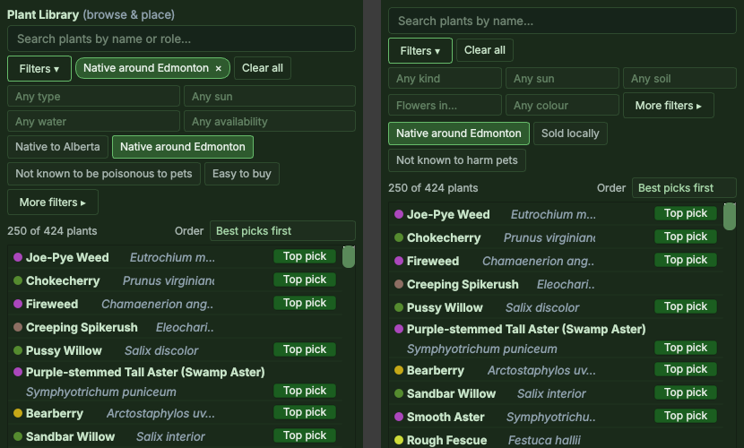

# V3.57 · Filters you can read (F272)

*The owner, 18 November 2026, with a screenshot of Placement › Plants with the filters open:
"Next address the mess that is the filters, order by, plant library browsing menu. It needs to be
simple, intuitive and can drop what isn't useful to do so."*

## What the review measured

The panel rendered offscreen at 405 px, in both apps, and every filter counted against the 250
Edmonton natives the simple app opens on (424 in the catalogue):

| Control | Keeps | Finding |
|---|---|---|
| Native to Alberta | 250 of 250 | Beside *Native around Edmonton* it changes nothing |
| Perennial | 242 | Almost nothing |
| Leaves out known spreaders | 240 | Spreading is recorded for 16 plants |
| Easy to buy | 187 | Disagreed with the dropdown beside it… |
| Availability: Available | 70 | …two names for one idea, two answers |
| Availability: Seed only; Role: Canopy layer | 0 | Choices that always empty the list |
| Role: Wildlife habitat | 209 | Nearly everything |
| Water: Low / Medium / High | | The plant page says dry / average / moist (V3.56) |

And in the layout: the filter that was on showed twice (the toggle and its chip beside *Filters*);
a page title, *Plant Library (browse & place)*, said again what the tab says; six orders, three of
them overlapping (*Best picks first* ranks by what a plant feeds, *Animals supported* by the same
records, *Recorded near this site* answers what the native filter answers better); with Advanced
tools on, every row carried a zone chip (Z2–7 down a list of natives) and an AB chip (on a list
already filtered to natives). Open, the filters took the list down to 273 px.

## What the owner decided

1. **Order**: Best picks first, Name, Kind, Tallest first.
2. **The buying filter** means on a local nursery's list, nothing else: *Sold locally*, 70 plants.
3. **The fold stays**: "I do think hiding the filters is a nice touch for visual simplicity." The
   owner asked what the chip row was: the green pill beside *Filters* for each filter that is on,
   with a × to take it off. So the chips stay **while folded**, where they are the only sign the
   list is filtered, and go while the filters are open, where the controls say it themselves.

## What changed

- **First tier** (`filter_area.EVERYDAY`): Kind, Sun, Soil, Flowers in, Colour, three to a row,
  *More filters* in the spare cell; Native around Edmonton, Sold locally, Not known to harm pets.
- **More filters**: What it does, Fruits in, Restoring toward; Native to Alberta, Food for a
  fussy eater, Edible, Not known to harm people, Has a photo.
- **Gone from the picker**: Availability, Easy to buy, Perennial, Leaves out known spreaders.
  The search parameters stay (the generator and the design goals read `common_only`,
  `perennial_only` and `well_behaved_only`). Criteria saved with `common_only` or an
  Availability list read as Sold locally (`plant_filters._RENAMED`).
- **Plain words**, the plant page's: Sun *Full sun / Part shade / Shade*, Soil *Dry / Average /
  Moist*, Kind with **Grasses & sedges** one choice (`KIND_TYPES` expands it to grass, sedge and
  rush), *What it does* down to ten roles a yard is planted for, in words (`ROLE_FILTER`:
  Bees and butterflies, Caterpillar food, Feeds many caterpillars, Bird food, Nesting material,
  Adds nitrogen, Holds a slope, Windbreak, Hedge, Showy). `ROLE_LABELS` is unchanged: the list's
  words and the website read it.
- **Orders**: four. Kind orders trees, shrubs, vines, wildflowers, herbs, groundcovers, grasses,
  ferns, water plants (it had sorted the type names A to Z, so water plants came first).
  `order_plants` still takes `suits` and `wildlife`.
- **Rows**: the band's chip in both apps, with *Not native* marking an off-list plant (the
  exception marked, not the rule); no zone or AB chip.
- **No page title**; the search box says *Search plants by name…*.

The list starts at 225 px open (273 before) and 102 px folded (122).

## Left alone

- The community builder's own filters (`polyculture_panel`) are a different control.
- The Edmonton list's toggle is still a toggle, not a three-way native choice; Native to Alberta
  is behind More filters for the reader who wants the province.
- Pet and people safety still pass an unchecked plant, and say so in their tooltips (P9).

## Ceilings

`filter_status.py` 300 → 320 (306: the chips follow the fold). `plant_filters.py` stays at 519 of
520 by moving the Kind and role tables to `plant_facets.py`.

