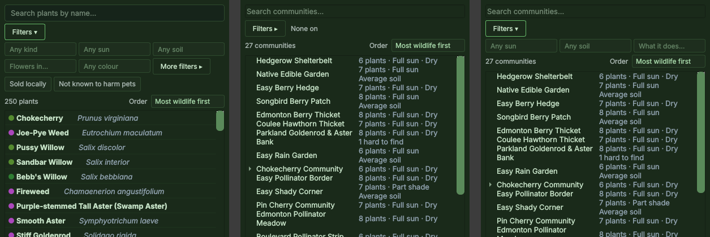

# V3.58 · Edmonton's plants, ungraded (F273)

*The owner, 18 November 2026, with a screenshot of Placement › Plants after V3.57, the filters open
with Fewer filters: "This is still kinda messy. Do you have suggestions for a more simple and
intuitive feel? The 'Top Pick' 'Good Pick' hierarchy implies that other picks are not good and this
is not true. As I move to make this an Edmonton specific app consider which options could be
dropped and how we can make that happen. Extend this work into the Communities tab as well."*

## What was suggested, and decided

Three questions, each answered with the recommendation:

1. **The grades go.** No *Top pick* or *Good pick* on a row or at the top of a plant's page. The
   list still opens on what feeds the most, the order renamed **Most wildlife first** (it was
   *Best picks first*, which said the same thing). One chip stays because it is a warning:
   **Needs a pond**. *Not native* stays in the table for a plant opened from a design that holds
   one, and is never seen in the list.
2. **Edmonton only, even in Advanced.** The region's 250 natives are the catalogue, not a filter:
   `native_here.catalogue_scope()` returns `{"local_native": True}` when the region pack's
   `defaults.local_natives_only` is set (Edmonton's is), and the Plants tab's picker, the community
   builder's picker and the community list search inside it unseen: no chip, nothing for Clear all
   to take off, "250 plants" not "250 of 424". **The pack field changed meaning**: it had turned
   the list on at a cold start in the simple app (ED-10, V3.26); now it makes the list the
   catalogue in both apps. A pack without it keeps every filter, the region tree included.
3. **Communities fold like Plants** (`src/community_filters.py`).

## What left

Plants tab: *Native around Edmonton* and *Native to Alberta* (both always true now), *Restoring
toward* (the region tree), *Has a photo*. A dropped pin no longer ticks its region in a filter
nobody can see (`set_facet` ignores a filter the scope removed). Open, the filters are now three
rows: Kind, Sun, Soil / Flowers in, Colour, More filters / Sold locally, Not known to harm pets.

Communities tab: the title *Plant Community Library (saved communities)*, *Show variations* (each
community's arrow opens its variations), *Group by*, *Structure*, *Habitat* (28 places from
Cypress Upland to Tazin Lake Upland), four of the seven orders (Most members, Most native,
Recently changed, the old *Most wildlife*, which *Best picks* already was), the *Edmonton natives
only* box and its line counting the 47 hidden. What stays: search, Filters ▸ with Sun, Soil and
What it does inside, chips while folded, "27 communities", and Most wildlife first / Name /
Easiest to buy.

The community words are the plant filters' (`community_filters.DISPLAY` over the library index's
own labels, which stay the keys): Full sun, Part shade, Shade; Dry, Average, Moist; the functions
as Bees and butterflies, Caterpillar food, Feeds many caterpillars, Bird food, Nesting,
Windbreak, Adds nitrogen, Holds a slope, By water, Showy. *Generalist* and *Medicinal / Useful*
are not offered. A row reads "6 plants · Full sun · Dry", and "Average soil" where the dropdown
says "Average".

A row without a chip gives its chip's room to the Latin name (`_right_w(plant)`).

## Left alone

- `plant_priority`'s bands still rank (the generator, the order, the community order); only the
  names are no longer shown.
- The search parameters for the removed filters stay: the generator and the design goals read
  them, and a criteria dict saved with one still searches.
- The website keeps its own facets (G5).
- The Site tab's *Browse reference communities* link still opens the Communities tab; with no
  Habitat filter it opens the region's communities.

## Ceilings

`polyculture_panel.py` 2697 → 2494 (the header moved to `community_filters.py`, 196 lines);
`plant_filters.py` 519 of 520; `plant_priority.py` 388 of 400.

