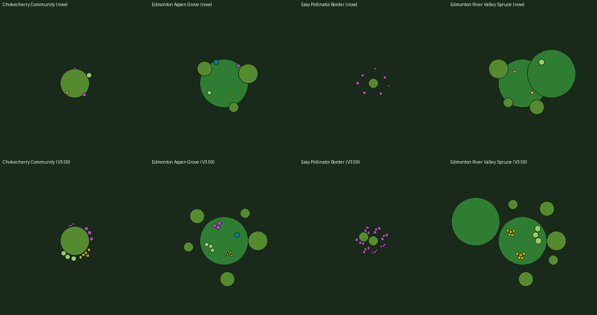

# V3.59 · Edmonton's communities, laid out and turnable (F274)

*The owner, 18 November 2026: "It looks like some communities need to be reworked as some lost
species and only have 3 akwardly placed plants? Each should've 5-7 species i think. Do a review and
rework of the communities to work for this Edmonton focused direction. Additionally id like to be
able to rotate the communities after (or before?) placing them."*

## What the review measured

- **No community had lost a member in the data.** Every seeded community held 6 to 11 species.
  What the owner saw was the map: a community placed **one plant of each species**, at offsets
  typed by hand a metre or two from its centre, under a tree whose mapped circle (half its planting
  spacing, 2.5 m for an aspen) covered them. Counting members wholly inside a bigger member's
  circle: Chokecherry Community showed **1 of its 6**, Pin Cherry 1 of 7, Parkland Woodland
  Wildflowers 1 of 8, the Edmonton Aspen Grove 2 of 8, Easy Shady Corner 3 of 7; nine of the 29
  Edmonton communities hid more than half their plants.
- **45 of the 74 seeded communities held a plant not native around Edmonton**, so the Edmonton
  catalogue (V3.58) hid them: for an Edmonton app, they had lost the species that made them.

## What the owner decided

1. **Drifts by kind**, "but not all communities need to have 25 plants. Can be as low as 7."
2. **Rework the useful ones, retire the regional ones.**
3. **Five kinds or more**, no upper limit ("Can be more than 7, no problem").
4. **Turn before and after placing.**

## The layout rule (`src/community_layout.py`, P1)

How many: a tree once; a shrub once if 2.5 m or more across, twice from 1.5 m, three times below;
a vine once; a wildflower, herb, grass, sedge, rush, fern or water plant in a drift of three; a
groundcover in five. At least 7 plants (smallest drifts grown), at most 25 (largest drifts cut,
never below two). Where: trees at the centre, shrubs round them, each drift in its own direction,
every plant on a spiral out from its species' place until it stands clear of the rest by half of
both spacings, where the map's circles meet. A shade plant may stand under a tree's crown, never
within 1 m of the trunk; a sun plant stands outside it. Deterministic, largest first so the map
draws small plants over big ones. Only the seeded communities are laid out this way: a person's
own keep the places they gave them.

Result: the 59 seeded communities place 8 to 25 plants each, 1,126 in all, **none out of sight**
(`community_layout.hidden`). Chokecherry Community is now the chokecherry, three each of nettle,
chives, prairie clover and yarrow, and five wild strawberries. A row reads "16 plants of 6 kinds".
The community page still shows each kind once.

## The library

**Retired (24)**: named for another region, or built mostly of plants from elsewhere (fewer than
half native around Edmonton), and the variations of a retired parent: Bur Oak Community; Dry
Foothills Juniper Slope; Edible Savanna; Foothills Fescue Wildflowers; Late-Season Pollinator
Refuge (3 of 7 local; its job is done by Parkland Goldenrod & Aster Bank and the aster
communities); Mixedgrass Late Aster & Goldenrod; Mixedgrass Prairie Patch; Moist Mixed Grassland
Pollinator Patch; the six Montane ones; Prairie Cactus & Succulent Garden; Prairie Dry Edge Misc;
Prairie Legume Nitrogen Bank; Prairie Pollinator Showcase; Prairie River Cottonwood Grove;
Sagebrush Steppe; Saskatchewan Valley Elm Grove; Southwest Alberta River Grove; the two Subalpine
ones.

**Reworked (30)**: each plant not native around Edmonton replaced by the Edmonton native of the
same kind that scores best on, in order, the same genus, a nitrogen fixer for a nitrogen fixer,
shared flowering months, a similar height, shared sun and soil, and what it feeds; never one
already in the community. Eight by hand, where the score's choice was wrong (a second milkweed or
false dragonhead is dropped rather than doubled; the conifer edge gets White Spruce, not a birch;
the violet carpet keeps its three Edmonton violets and gains Wild Bergamot for the adult
fritillaries; Switchgrass becomes Canada Wild Rye, not a wet-ground manna grass). *Wet Meadow Aster
& Monkeyflower* lost both monkeyflowers and is **Wet Meadow Asters**. The descriptions and pattern
cards were edited where they named a plant that left. The full swap table:

| Community | Swaps |
|---|---|
| Saskatoon Berry Community, Berry Focus, Native Understory | Silvery Lupine → Canada Milk Vetch |
| Prairie Pollinator Garden, Aspen Parkland Edge | Canada Goldenrod → Late Goldenrod |
| Tall Prairie Meadow | Maximilian Sunflower → Stiff Sunflower; Smooth Blue → Slender Blue Beardtongue; Switchgrass → Canada Wild Rye |
| Aromatic Herb Circle | Sitka Valerian → Wild Chives; Self-heal dropped |
| Native Berry Hedge | Silvery Lupine → Canada Milk Vetch; Canada → Late Goldenrod |
| Wildlife Corridor Hedge | Black → Round-leaved Hawthorn |
| Keystone Pollinator Mound | Canada → Late Goldenrod; Maximilian → Stiff Sunflower |
| Caterpillar Host Garden | Showy Milkweed dropped (Oval-leaf stays); Eastern Red → Blue Columbine |
| Continuous Bloom Pollinator Strip | Dotted → Meadow Blazingstar; Canada → Late Goldenrod |
| Riparian Willow Thicket | Showy → Oval-leaf Milkweed |
| Backyard Meadow Patch | Little Bluestem → Canada Wild Rye; Silvery Lupine → Canada Milk Vetch |
| Parkland Berry Thicket | Black → Round-leaved Hawthorn; Golden Currant → Wild Gooseberry; Thimbleberry → Wild Raspberry |
| Parkland Sunny Meadow | Maximilian → Stiff Sunflower; Jerusalem Artichoke → Nuttall's Sunflower; Common Paintbrush → Boreal Yarrow |
| Parkland Conifer Edge | Balsam Fir → White Spruce; Fragrant Sumac → Northern Black Currant |
| Moist Parkland Hollow | Showy → Smooth Fleabane; Spring Beauty → Palmate-leaved Coltsfoot |
| Boreal Conifer Understory | Low Bilberry → Velvet-leaf Blueberry |
| Boreal Bog Edge | Bog → Velvet-leaf Blueberry; Dwarf Birch → Northern Black Currant |
| Dry Prairie Wildflower Tapestry | Fuzzy-tongue → Lilac Penstemon |
| Prairie Spring Ephemerals | Yellow Puccoon → Meadow Arnica; Crowfoot → Western Canada Violet; Prairie Onion → Wild Chives |
| Prairie Grassland Forbs | Western Blue Iris → Purple Avens; Balsamroot → Philadelphia Fleabane; Woolly → Slender Cinquefoil; Twin → Meadow Arnica |
| Riparian Willow & Alder Grove | Short-capsuled → Sandbar Willow |
| Streambank Stabilizer Strip | Douglas Maple → Sandbar Willow; Alder-leaved Buckthorn → Northern Black Currant; Trailing → Dwarf Raspberry |
| Wet Meadow Asters | both monkeyflowers dropped |
| Marsh Margin Forbs | False Dragonhead dropped (Ledingham's stays) |
| Pond & Aquatic Edge | Broad-leaved Arrowhead → Broad-leaved Water-plantain |
| Open Water Submergents | Canada Waterweed dropped |
| Fritillary Violet Carpet | Crowfoot Violet dropped; Round-leaved Yellow Violet → Wild Bergamot |

Every one of the 59 now has every member native around Edmonton and at least five kinds
(`tests/test_community_layout.py`). Schema v102 reseeds them; a person's own communities are kept.
**These are the owner's to review**: a swap is a judgment from the records, not a botanist's.

## Turning

- **Before placing** (`src/community_turn.py`): while a community follows the cursor, *Turn 45°*
  on the bar over the map, or **R** with the map focused, turns it and its preview 45° clockwise;
  it stays turned for the next click. Single placement only: a row or grid of communities keeps
  them as made.
- **After placing** (`html/map/11b-turn.js`): right-click any plant of a placed community, *Turn
  community 45° clockwise* or *anticlockwise*, about its own centre. The move goes to Python as the
  group move a drag sends (`onPlantGroupMoved`), so it is one undo step and saved the same way. In
  a row of communities only the one clicked turns.

## Left alone

- A person's own communities keep their hand-placed offsets; the builder's *Auto-arrange by layer*
  is unchanged.
- Plan My Yard places a community pocket at the members' own offsets
  (`design_api.place_polyculture`), so its plans now plant the drifts too, and fewer pockets for
  the same cover (`llm_design._community_size` counts plants). Its digest names each kind once.

## Could not verify

The map was not driven: the layouts are checked geometrically (circles at half the spacing, as
`placePlantMarker` draws them) and the turn's arithmetic in node, not by right-clicking a placed
community in the real window.

