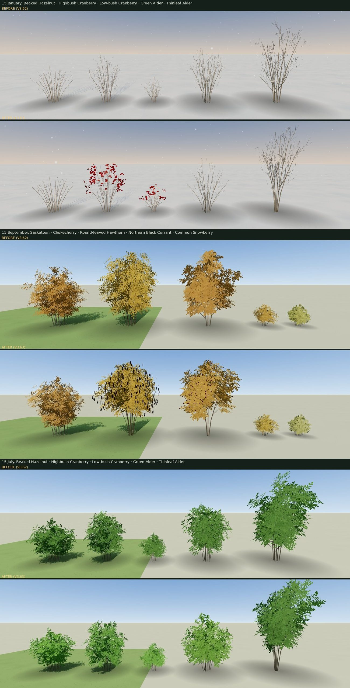

# V3.63 · Shrubs you can tell apart (F268)

**The owner:** "Go ahead with the leaf colour, fruits you can see and crown outlines."

The three fixes [V3.62](V3.62-the-models-read-again.md) ranked for the shrubs. Its four-season
lineup showed a dozen of the 34 native shrubs (hazelnut, both cranberries, both alders,
saskatoon, chokecherry, hawthorn, northern black currant, snowberry) as one green oval in July,
32 fans of brown twigs in January, and fruit on almost none of them. The causes, from that plan:
26 of the 34 shared one green and 24 had no leaf surface; 20 shared one outline; and the fruit
was points the size of one berry, behind the leaf cards, gone when the season ended.

## What was read

All 34 native shrubs, off their reference photographs (`data/fetched/model_refs/`, the V3.62
review's picks: two of the whole plant, two of the leaf, one in fruit, one in winter, beside the
model), with `scripts/leaf_readings.py add`. For each:

- **`leaf_color`**, the summer leaf as the photographs show it, `#rrggbb` (the V3.51 column, the
  scene's first choice). The spread is the point: Labrador tea a dark olive, chokecherry and
  bracted honeysuckle a deep glossy green, hazel and the currants a fresh yellow-green, saskatoon
  and the snowberries blue-green, the willows grey-green, silverberry and silver buffaloberry
  silver. **Canada buffaloberry is no longer silver**: its leaves are dull green above and only
  silver beneath, and it was drawn all silver (V3.49's open item).
- **`leaf_surface`**: glossy (chokecherry, bracted honeysuckle, green alder, hawthorn, the
  bristly black currant and the gooseberry, pussy willow), pubescent (both buffaloberries,
  silverberry, shrubby cinquefoil), glaucous (basket and narrow-leaf willow, common juniper),
  matte for the rest. It already reached the shrub material (`leafSurfaceFor`); 24 were blank.
- **`crown_shape`**, in a shrub's own words (new vocabulary `SHRUB_CROWN_SHAPES`: vase, rounded,
  mound, spreading, upright, irregular, mat; a tree's words stay a tree's), and **`crown_clear`**
  where a big shrub stands on a short bare trunk (chokecherry and hawthorn 0.25, thinleaf alder
  0.2, pussy willow and silver buffaloberry 0.15).
- **`fruit_held_until`** (new, schema v104), the last month the fruit is still on the bare twigs,
  read off winter photographs: snowberries, highbush cranberry and the three roses to March,
  silverberry to March, juniper to April, silver buffaloberry to December, chokecherry and hawthorn
  to November, low-bush cranberry to January.

Fruit colours are not the owner's answers (those are the flower colours, V3.34), and the
photographs were unambiguous, so **seven were corrected** through the fruit seeder, which already
owned such corrections (`seed_fruit_morphology.FRUIT_COLOR_FIX`, where pin cherry's was): wild
black currant, bristly black currant and bracted honeysuckle **black, not red**; wild gooseberry
dark purple; wild red currant a brighter red; and two shrubs whose fruit nothing recorded, common
juniper (dusty blue berry-cones) and silverberry (silvery drupes), which are what those two are in
winter. Round-leaved hawthorn gained the `pome` form it lacked. V3.48 had listed the three black
fruits for the owner; they are changed here because they are fruit, not flowers, and the owner
asked for fruit you can see. **The owner may want to look at those seven** (the table below).

| shrub | was | now |
|---|---|---|
| Wild Black Currant | red `#9a1f1f` | black `#1c1a22` |
| Bristly Black Currant | red `#9a1f1f` | black `#1c1a22` |
| Bracted Honeysuckle | red `#c1271d` | black `#1c1a22` |
| Wild Gooseberry | red `#9a1f1f` | dark purple `#3e2236` |
| Wild Red Currant | `#9a1f1f` | bright red `#c8202a` |
| Common Juniper | none | dusty blue `#4a5a7a`, berry |
| Silverberry | none | silvery `#b5b6a4`, berry |

## What was drawn

1. **Leaf colour and surface**: data only. Nothing in the viewer changed for them.
2. **Crown outlines** (`03d-woody.js`): `shrub_habit` passes `crown` and `clear` in the drawn
   block, and a crown that was read replaces the form's outline (`_wdCrownEnvelope`), the way the
   branches turn (`_WD_CROWN_BIAS`) and where a clump's stems end (`_WD_CROWN_STEM`): a vase narrow
   at the foot and widest high up, a rounded ball on a short foot, a mound widest on the ground, a
   spreading crown broad from a narrower base, an upright one straight-sided, an irregular one
   lobed and open. `clear` keeps the stems bare to that height and draws them closer together. The
   form still says how the stems grow (a thicket's suckers, an arching cane). Both are in the
   body's cache key. A shrub with no crown read keeps its form's outline.
3. **Fruit you can see** (new chunk `15d-woodyfruit.js`): a shrub drawn from its own numbers, or a
   tree from its own crown, carries its fruit as cut-out cards on the ends of its outermost shoots,
   as its flower clusters have been since V3.49: a bunch of berries, a string of currants, a raceme
   of chokecherries, a cluster of hips or of pomes, a flat bunch of cranberries. `11-fruit.js`
   hands those plants over and keeps its points for the rest (vines, herbs). A card stands for a
   bunch, at a stated size by fruit form, enlarged on a tall plant by the blooms' own allowance and
   held to 1.8 on a shrub; how many a plant carries is from its crown's surface. **In the months
   after its season up to `fruit_held_until` the fruit stays on the bare twigs**, fewer of them
   (birds take the rest) and darker. `fruitInSeason` decides it, across the new year, and the
   points layer asks it too. Every number that is an estimate is named in the chunk's header.

## What the pictures show

Ten of the look-alikes rendered side by side through the real viewer, before (the V3.62 branch's
viewer and catalogue) and after, on 15 July, 15 September and 15 January (`render_yard`'s probe,
the plants at their real sizes from one camera).

- **January is where it changes most.** Before, all ten were fans of brown twigs. After, highbush
  and low-bush cranberry hold red bunches on their bare twigs, and the snowberry its white berries;
  the rest are twigs, as the photographs show them in winter (a chokecherry's and a hawthorn's are
  gone by November).
- **September**: chokecherry carries hanging strings of black cherries, highbush cranberry red
  bunches, snowberry white ones; hawthorn's haws are there but small and dark against orange
  leaves. The season model turns every shrub gold by 15 September (below), which hides more than
  the fruit does.
- **July**: the differences are smaller than the owner may hope. The greens now differ (saskatoon
  blue-green, hazel fresh yellow-green, Labrador tea dark olive), chokecherry and hawthorn stand on
  a short bare trunk, the thinleaf alder is a narrow vase on its stems; but a hazel, a highbush
  cranberry and a green alder are still much the same rounded mass at a yard's distance. Two
  reasons, both in the code: every shrub is still drawn to the same width rule (1.5 times its
  spacing, below), which fixes how tall against how wide it is whatever its crown; and the leaf
  cards are the same size whatever the leaf (V3.62's "leaf size cancels out"), so a coarse hazel
  and a fine snowberry have one texture.

Close up (one shrub framed alone) the fruit is plain: a snowberry's white bunches in September and
on the twigs in January; a highbush cranberry red all over in September and in January.

## Found on the way

- **The bare trunk was measured along a stem, not up the shrub.** A clump's outer stems lean, so
  a crown read bare to a quarter of its height came out leafy from an eighth. It is converted to a
  height on each stem now; the render test caught it.
- **White fruit darkened for winter was grey on the snow.** Fruit darkens in winter only where it
  is a dark colour to begin with (a hip, a cranberry); a snowberry's and a silverberry's stay pale.
- **Round-leaved hawthorn had no fruit form**, so its haws were drawn as single berries; and the
  fruit seeder's check lists *False Solomon's Seal* without one and an old name (*Maianthemum
  racemosum*) it no longer finds. Neither is a shrub; left for the herbs.

## Not done, and why

- **A shrub's width.** Still 1.5 times its planting spacing. The readings gave a width for each
  shrub, but `mature_canopy_m` also sets how far apart Plan My Yard plants them and how full the
  Overview says a yard is, so changing it changes those headlines. That is the owner's call, not a
  side effect of a drawing fix. The widths read, for when it is made (grown width, off the
  photographs, against a person or a fence where one stands beside it):

  | shrub | now (1.5 × spacing) | read |
  |---|---|---|
  | Basket Willow | 3 m | 2.5 m |
  | Beaked Hazelnut | 3 m | 3 m |
  | Bracted Honeysuckle | 2.25 m | 2 m |
  | Bristly Black Currant | 1.5 m | 1.5 m |
  | Canada Buffaloberry | 2.25 m | 2 m |
  | Chokecherry | 4.5 m | 3.5 m |
  | Common Juniper | 2.25 m | 2.5 m |
  | Common Snowberry | 1.5 m | 1.5 m |
  | Green Alder | 3.75 m | 3.5 m |
  | Highbush Cranberry | 3 m | 3.5 m |
  | Labrador Tea | 1.2 m | 1.2 m |
  | Low-bush Cranberry | 2.25 m | 1.5 m |
  | Meadowsweet | 1.5 m | 1 m |
  | Narrow-leaf Willow | 3 m | 3 m |
  | Northern Black Currant | 1.8 m | 1.5 m |
  | Prairie Rose | 1.2 m | 0.8 m |
  | Prickly Wild Rose | 1.5 m | 1.5 m |
  | Pussy Willow | 3 m | 4 m |
  | Red Osier Dogwood | 3 m | 3 m |
  | Round-leaved Hawthorn | 4.5 m | 4 m |
  | Sandbar Willow | 2.25 m | 2.5 m |
  | Saskatoon Berry | 3.75 m | 3 m |
  | Shrubby Cinquefoil | 1.5 m | 1 m |
  | Silver Buffaloberry | 3 m | 3.5 m |
  | Silverberry | 3 m | 2.5 m |
  | Skunk Currant | 1.5 m | 1.2 m |
  | Thinleaf Alder | 4.5 m | 4.5 m |
  | Velvet-leaf Blueberry | 0.75 m | 0.6 m |
  | Western Snowberry | 1.5 m | 1.2 m |
  | Wild Black Currant | 2.25 m | 1.5 m |
  | Wild Gooseberry | 1.5 m | 1.2 m |
  | Wild Raspberry | 0.9 m | 1.5 m |
  | Wild Red Currant | 1.5 m | 1 m |
  | Woods' Rose | 2.25 m | 1.5 m |

- **Autumn by species**, catkins and spring flowers on bare twigs, opposite leaves drawn as pairs,
  a leaf's own size kept in its card: the other items on V3.62's list. The first matters more than
  it looked: on 15 September every deciduous shrub is already gold (`scene_season` turns them all
  14 days before the first frost), so the September fruit is seen against one colour.
- **Cones** on the alders: a new fruit form, and the trees' cones are still open too.
- **Stylised** draws none of this, as before.

## Not verified

- **On a real GPU**, and **frame rate**: a shrub in fruit now carries up to 400 cards of two
  triangles. Not measured on the owner's laptop (Ctrl+Shift+F in the 3D window shows it).
- **My readings**: one reader, small photographs. A leaf colour from a photograph depends on its
  light; each was read from two or more.
