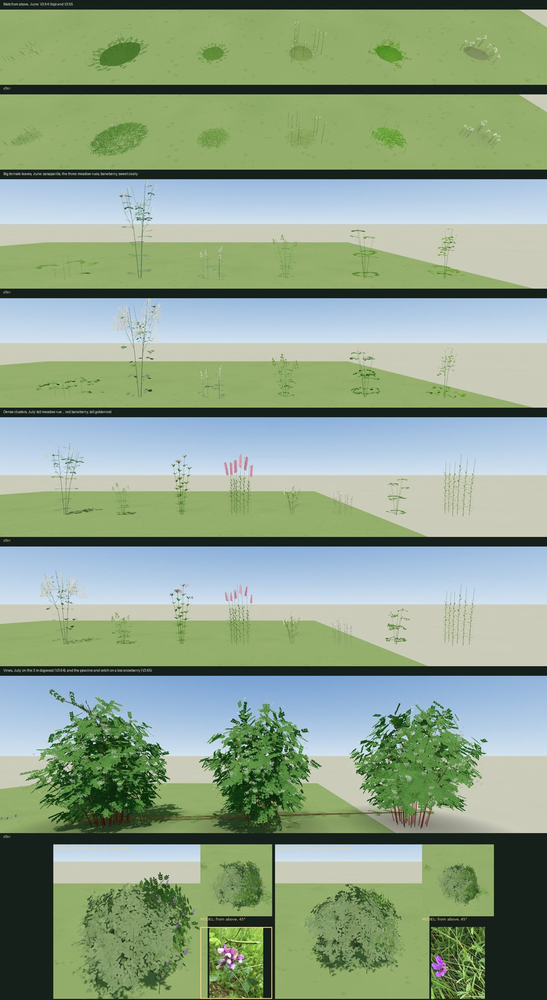

# V3.65 · Mats, vines, big leaves and flower clusters at their size (F268)

**The owner:** "Continue with outstanding items", the next of the steps
[V3.62](V3.62-the-models-read-again.md) ranked after [V3.64](V3.64-leaves-heads-and-spikes.md):

4. **Mats drawn as a plate** (`habit`, `dense` on bog cranberry, bearberry, twinflower,
   sweet-scented bedstraw, American brooklime, field chickweed): a solid green 12-sided mound with
   sprigs round its edge.
5. **Vines lost in their host** (both peavines, wild vetch, blue clematis, twining honeysuckle):
   "the pair reads as one dense rounded shrub", and the peavine's purple flowers "show as white".
6. **Big compound leaves lying flat** (wild sarsaparilla, the three meadow-rues, red baneberry,
   smooth sweet cicely): "a few giant flat leaf cut-outs lying in rings".

And the two plants V3.64 left "still blank": tall meadow rue and the swamp aster.

## What was found first

**Neither "blank" plant was blank.** Measured in the real viewer, tall meadow rue carried 12
cluster cards in July and the swamp aster 72 heads in August. Both were too small to see from the
sheet's distance. The swamp aster's heads are 3 cm, its size; that it reads as bare stems is its
habit (24 thin upright stems), left for the open list below. Tall meadow rue's plume was drawn
**5 cm long**. A card's size was estimated from the flower's width and the count of florets
(`woodyClusterSize`), and for a loose panicle of 80 flowers half a centimetre across that gives a
5 cm cluster where the photographs show a plume 30 cm long and 20 wide.

**The peavine's "white flowers" were the dogwood's.** The review puts every vine on the gallery's
host, a 3 m red osier dogwood, which flowers white in the same weeks: 346 white cluster cards
against the peavine's 44 purple ones. The peavine's own were the recorded purple. And the dogwood
itself looked pinnate: its opposite leaves were painted as two even rows of pairs on each shoot
card, which is the outline of a pinnate leaf, so host and vine were the same texture.

## What was read

**The flower clusters of 40 wildflowers**, length and width of one spike, raceme, panicle or flat
top, off their reference photographs (a hand or the leaves for scale), into `head_length_cm` and
`head_width_cm`. Until now those held a grass's seed head only; on a wildflower they are its
cluster, and `grass_habit` still draws a tuft only for a graminoid (a test). The four water plants
on the list (broad-leaved water-plantain, sago pondweed, spiked water-milfoil, water arum) were not
read: their own bodies give a card no stem tip, so they keep their florets (V3.64).

| plant | length × width (cm) | plant | length × width (cm) |
|---|---|---|---|
| Alpine Hedysarum | 12 × 4 | Northern Hedysarum | 8 × 5 |
| Ascending Milkvetch | 4 × 3.5 | Pearly Everlasting | 4 × 8 |
| Boreal Yarrow | 3 × 7 | Plains Wormwood | 20 × 4 |
| Canada Milk Vetch | 10 × 3.5 | Prairie Goldenrod | 10 × 6 |
| Common Alumroot | 15 × 3 | Prairie Sagewort | 15 × 3 |
| Elegant Goldenrod | 15 × 6 | Purple Prairie Clover | 4 × 1.5 |
| Evening Primrose | 15 × 8 | Red Baneberry | 4 × 3.5 |
| Ledingham's False Dragonhead | 8 × 3 | Roadside Agrimony | 20 × 2.5 |
| False Solomon's Seal | 8 × 5 | Scarlet Butterfly Plant | 10 × 4 |
| Fireweed | 25 × 8 | Sticky Goldenrod | 12 × 3 |
| Flat-topped Goldenrod | 5 × 12 | Stiff Goldenrod | 6 × 12 |
| Flat-topped White Aster | 8 × 15 | Sweet-scented Bedstraw | 2.5 × 2.5 |
| Giant Hyssop | 8 × 2.5 | Tall Goldenrod | 25 × 18 |
| Golden Bean | 8 × 4 | Tall Meadow Rue | 30 × 20 |
| Hooded Ladies' Tresses | 8 × 2.5 | Tall Showy Yarrow | 4 × 8 |
| Joe-Pye Weed | 10 × 18 | Veiny Meadow-Rue | 15 × 6 |
| Late Goldenrod | 25 × 15 | Water Smartweed | 4 × 1.8 |
| Northern Bedstraw | 12 × 6 | Western Meadowrue | 15 × 10 |
| Wild Licorice | 5 × 2.5 | Wild Lily-of-the-valley | 4 × 1.5 |
| Yellow Owl Clover | 8 × 2.5 | Yellow-flowered Locoweed | 6 × 2.5 |

**A cluster's size alone is its own reading**, as a leaf colour has been since V3.64
(`scripts/leaf_readings.py`): it needs no habit, and it **leaves both provenance pairs as they
were**. The first write of this batch marked each plant's flowers `photo`, which would have said
its petal count, floret count and flower width were read too, when they were the seeder's
estimates for most of the 40; that was undone before anything was committed, and a test holds it.
So the readings carry no citation of their own: this table is their record. Schema v106, no DDL.

## What was drawn

1. **A cluster at the size read** (`15c-woodybloom.js`). Where a wildflower's cluster was read the
   card is drawn to it, never taller than the plant's share for its flowers: `_wbFill` knows how
   much of its card each kind of painted cluster fills, so the painted cluster, not the card, is
   the size read. A raceme's flowers now get smaller and closer in toward the buds at the top:
   fireweed's racemes had been pink bars. A cluster card paints up to 140 flowers (70 before), so
   a cluster of many tiny ones (Joe-Pye weed's dome) is not half bare.
2. **A mat is leafy shoots** (`03c-leafy.js _leafyMat`). The plate is gone. A mat's leaves are
   cut-out cards of its own leafy shoots (`_wdSpray`, the shrubs' since V3.49), lying nearly flat
   along trailing runners, heaped a little over the root, as many as cover the ground
   (`MAT_COVER` 1.1, overlaps counted) and enlarged up to `MAT_GAIN_MAX` (2.5) where the budget
   cannot buy that many at life size. They are a second mesh in the body's frame
   (`leafyCardsMesh`, placed by the herb layer with the body). A mat stands as deep as three
   leaves are long, at most 40% of its height. The pussytoes' carpets of rosettes keep their
   rosettes and the mound under them; creeping juniper is still unread and keeps the shared body.
3. **A big ternate leaf divides twice** (`_lbLeaf`, from `TERNATE_TWICE_M`, 10 cm): three stalks
   of three stalks of three leaflets, each stalk drooping its own amount (about `TERNATE_DROOP`)
   and each leaflet rolled about its midrib, so the leaf is a dome of small leaflets. Drawn level,
   nine big leaflets on one plane were a disc seen edge on, which is the "rings" the review saw. A
   leaf's cost is counted from a leaf of its own size, so a columbine's small ternate leaf is not
   charged for the division it does not get. The lowest leaf of a big-leaved stem starts at 60% of
   a leaf's length up (never above 40% of the stem): a 25 cm baneberry leaf had lain on the ground.
4. **Opposite leaves turn a quarter at each node** (`_wdSpray`, every shrub drawn from its own
   numbers): every other pair faces the eye and is drawn short, close to the shoot. Eight native
   shrubs have opposite leaves (red osier dogwood, the two snowberries, the two cranberries,
   bracted honeysuckle, the two buffaloberries); they no longer read as pinnate. A pair drawn
   short is still as much leaf, so the cover sum that decides how many cards a crown needs counts
   it laid flat (`leafCover`); counting only what is painted, the render test's 3 m dogwood had
   its 8 cm leaves enlarged 13% to cover its crown, which it caught.
5. **A read vine clothes its side**: its leafy shoots follow one another at 0.3 of a shoot's
   length up a stem (`VINE_SHOOT_GAP`, 0.55 before).
6. **The review stage** (`sprite_gallery`): a herbaceous vine (the two peavines, wild vetch)
   scrambles over a 1 m western snowberry (`VINE_HOST_LOW`), not the 3 m dogwood, as the
   photographs show them in grass and low shrubs. The woody vines keep the dogwood. This changes
   what the gallery and the sheets show, not what a design draws: a vine in a design still climbs
   whatever stands beside it.

## What the pictures show

- **Mats**: the plates are gone. Bearberry, twinflower and brooklime are carpets of small leaves
  with the ground showing at their edges; bog cranberry is a faint haze of tiny leaves, which is
  what it is, thread-thin stems over moss.
- **Big leaves**: sarsaparilla's umbrellas and the baneberry's sprays read as leaves. They are
  still too few: what holds them back now is the recorded leaf counts (sarsaparilla one leaf a
  stem, veiny meadow-rue three), not the drawing.
- **Clusters**: tall meadow rue carries a white plume; fireweed tapering spires; Joe-Pye weed a
  pink dome.
- **Vines**: the purple peavine is plain on the snowberry, darker pinnate sprays with purple
  racemes. Wild vetch is fainter; its recorded flower colour (pink, the owner's) is paler than the
  purple its photographs show.

## Re-scored

The 60 plants this increment touched (the six mats, the five vines, the six big-leaved plants,
the 40 with a cluster read, the eight opposite-leaved shrubs, overlapping) were rendered again and
read again against their photographs (`model_review.py`, pass V3.65; each keeps its earlier
reading under `earlier`).

**Mean 4.25 → 4.68; 16 rose, 2 fell, the rest stood.** Across all 250 the mean is now 5.14
(5.04 after V3.64), and the plants at 2 or below are 6 (13).

- **Rose most**: Joe-Pye weed 3 → 6, twinflower 2 → 5, purple peavine 2 → 5, bearberry 2 → 5,
  tall meadow rue 3 → 5, brooklime and the cream peavine 2 → 4, bog cranberry 1 → 3; the
  meadow-rues, field chickweed, northern bedstraw, flat-topped goldenrod and boreal yarrow by one.
- **Fell**: common alumroot and sticky goldenrod 5 → 4. Drawn at the length read, **a long narrow
  spike of tiny flowers is a solid bar**: the card's smaller copies keep its share of painted
  pixels (`_wdMip`, which is what keeps a shrub's leaves from going bare with distance), so a
  narrow column of dots becomes one stripe a few pixels wide. Roadside agrimony shows it too, and
  alumroot's is in the recorded red. That is the next thing to fix on the clusters.
- **Stood**: the big ternate leaves are divided twice and now face several ways, but red baneberry,
  sarsaparilla and sweet cicely still read as rings or arcs of leaves round bare stems: too few
  leaves (the recorded counts) held too low. Blue clematis and twining honeysuckle stay lost on
  the dogwood, which also flowers white in their months. The opposite-leaved shrubs read the same
  at the sheet's distance; close up their shoots are pairs, not pinnate fronds.

## Not done, and why

- **The swamp aster** reads as a bundle of bare stems: 24 flowering stems, each thin and upright
  with narrow leaves. Its photographs show a bushy plant branched above with heads all over its
  top. That is its habit (and the asters' `HEADS_PER_CLUSTER`), not its flowers; left for a
  habit pass over the tall asters.
- **The vetch's colour** is the owner's answer (V3.34); its photographs show it more purple.
- **Shrub width, autumn by species, catkins, cones, the water plants, the horsetails, prickly-pear,
  creeping juniper, ostrich fern**: as before (V3.63, V3.64).

## Not verified

- **On a real GPU**, and **frame rate**: a mat is now up to about 900 cards of two triangles,
  within its 1,800-triangle budget; not measured on the owner's laptop.
- **My readings**: one reader, small photographs, a hand or a leaf for scale where there was one.
- **The full suite**: SUITE
