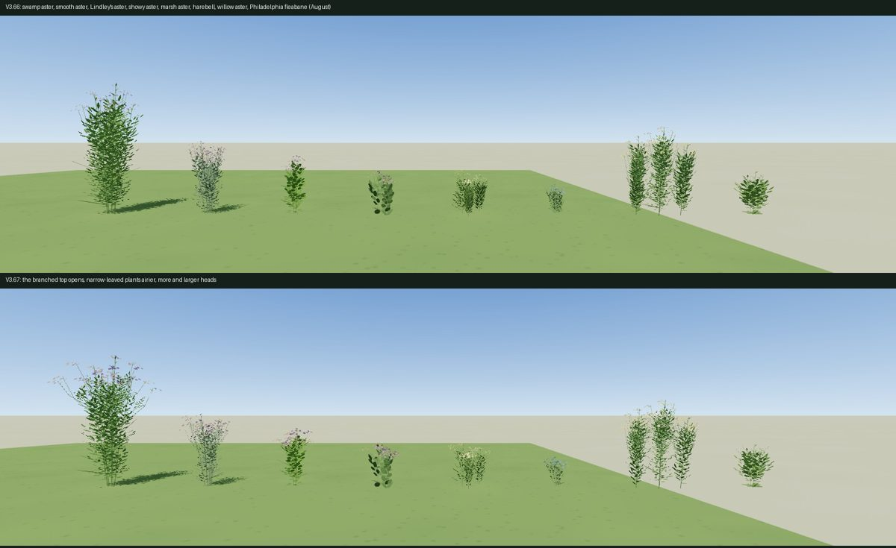

# V3.67 · Flowers you can see, and plants that are not columns (F268)

**The owner:** "Okay fix the remaining flowers next. Both the ones that are hard to see and the
ones reading as columns": the first and third rows of
[V3.66](V3.66-leafy-stems-and-a-fresh-reading.md)'s "Still wrong" table, `flower_size` (40
plants) and `dense` (20, of which 14 are wildflowers; the 6 shrubs and creeping juniper are other
faults and are left).

## What was found

Eight of them side by side with a habit photograph and a flower close-up (the asters, the
fleabane, cut-leaved anemone, evening primrose, prairie thistle) showed one fault behind both
words. **A branched aster is a column of leaves with a few specks on top, where its photographs
show leafy stems opening into a wide, flowering top.** Three numbers made it so:

- a stem recorded `branched_above` forked into branches reaching out **0.12 of the plant's
  height**: on a 1.8 m swamp aster, 22 cm. The flowering top was no wider than the stems;
- V3.66's leafy-shoot cards (`03g-stemleaves.js`) filled every stem evenly **from its foot to its
  flowers**, the branched top included, at the same cover whatever the leaf: a narrow-leaved
  marsh aster, harebell or blazingstar was filled as solidly as a broad-leaved plant;
- each counted flower cluster of a branched aster carried **3 heads** (4 branched throughout),
  each **at least 3 cm**: 72 specks on a swamp aster whose photographs show it covered in
  daisies, and 3 cm is about six pixels at the review sheet's distance.

What was not the cause: the recorded colours (the asters are the owner's lilac, `#8e6fc4`, and
are drawn so; at a distance a lilac head with its yellow disc reads paler) and the plant's width,
which is 1.5 times its spacing as a shrub's is, and is the owner's open decision.

## What was drawn

1. **A stem branched above opens.** Its branches reach out `BRANCH_OPEN` (0.32) of its height,
   never past 85% of its outline's radius (`03c-leafy.js`): a swamp aster's top spreads to its
   outline, a 40 cm harebell's to 9 cm. A plant branched throughout is unchanged.
2. **The leafy shoots follow the plant's shape** (`03g-stemleaves.js`):
   - on a stem branched above, none above its first fork: that is the open top;
   - **the branches carry their own**, `HERB_BRANCH_CARD` (0.6) the size, as their leaves are
     drawn at half size, out of the same budget, so the top is leafy small branches and not bare
     sticks (the first build left them bare: a candelabra);
   - **narrow leaves fill less**: the cover scales with the leaf's width against an elliptic
     leaf's, down to `HERB_NARROW_FLOOR` (0.35) for a linear one.
3. **More heads, and larger** (`15e-heads.js`): `HEADS_PER_CLUSTER` 5 on a stem branched above
   and 6 branched throughout (3 and 4 before); `HEAD_MIN_M` 4 cm (3 before), still never more
   than 1.8 times a head's own width, which covers the solitary flowers too (the anemones, the
   violets, the lady's slipper).

All four are stated estimates in their chunks' headers.

## Found on the first reading, and fixed

All 139 wildflowers, herbs and groundcovers were rendered and the 106 whose drawing changed were
read against their photographs. Four faults showed, each fixed and the 139 rendered again before
anything was recorded:

- **A count already of heads was multiplied.** Prairie coneflower records 24 flowering stems, a
  head each; gumweed 40; hairy golden aster 32. Five heads to each buried them in 120 to 240
  daisies. The heads of a cluster are now capped so that all of a plant's heads cover at most
  `HEAD_COVER` (0.6) of its footprint: the coneflower keeps 2 a cluster, the swamp aster 5.
- **The open top left the tall plants thin.** With no leafy shoots above the first fork and the
  narrow-leaf rule at its first value, the swamp aster and flat-topped goldenrod were bare sticks
  with leaves at the foot. The shoots now run to the last fork, the narrow-leaf rule starts at 0.3
  of a leaf's width (`HERB_NARROW_FLOOR` 0.5), and `BRANCH_OPEN` is 0.25 (0.32 splayed leafy arnica
  and marsh aster like umbrellas).
- **The branches took the stem's cards.** Cards were shared evenly between the stems and the
  branches, so three short branches took three times the main stem's, at a branch card's smaller
  size: the plant got much less leaf than it was owed. They are shared by each path's length.
- **The small flowers of loose clusters were still specks** (lilac penstemon, marsh skullcap, tall
  lungwort, yellow avens): a loose cluster of showy flowers (each at least 1 cm, fewer than 15)
  draws them at least `LOOSE_MIN_M` (2.8 cm), at most 1.6 times. Tiny flowers stay as they are: a
  haze is what they look like. The path code moved into
`03g-stemleaves.js` (`noteStemPath`, `noteBranchPath`): `03c-leafy.js` is at its 680-line ceiling.

## Re-scored

At the lineup's distance the difference is the top: the swamp aster opens into a spray of heads,
Lindley's and smooth aster carry theirs over the leaves, the harebell's flowers read. The willow
asters' stands still read as columns from there; on their own sheets they are fine stands covered
in small white heads.

The 106 changed plants were read again against their photographs (`model_review.py`, pass V3.67;
the 81 whose reading did not change keep their V3.66 record). **25 readings changed; mean of
those 25 5.4 → 5.8, 11 rose, none fell.** Across all 250 the mean is **5.54** (5.50), at 7 or
above **33** (31). `flower_size` is on 27 plants (40), `dense` on 16 (20; 7 of those are shrubs
and creeping juniper, out of scope).

- **Rose**: Showy Aster and Willow Aster 6 → 7; Arctic Aster, Harebell, Lindley's Aster,
  Many-flowered Aster, Marsh Aster, Philadelphia Fleabane and Smooth Aster 5 → 6; Cut-leaved
  Anemone 4 → 5; Swamp Aster 4 → 5.
- **Read differently but no higher**: the loose-cluster plants (penstemon, skullcap, lungwort,
  avens). Their flowers now read, and what holds them below 7 is now the plant (a bushier body
  than the photographs' slender stems), so their fault changed and their score did not.
- **Still wrong**: the swamp aster's lower stems are a solid mass; the meadow-rues, tall meadow
  rue and veiny meadow-rue still `dense` under heavy blob leaflets (a leaf fault, not a flower
  one); meadow blazingstar's heads are still specks (a raceme of 8 big heads, drawn as florets);
  the asters' lilac reads pink at a distance (the recorded colour, the owner's); white prairie
  aster's heads now read larger than its photographs' small ones.

## Not verified

SUITE
