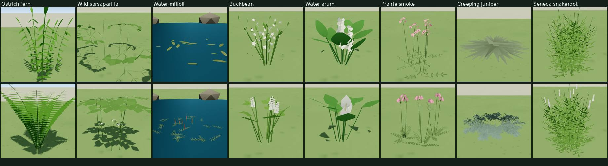

# V3.67, second sitting · The lowest models reworked (F268)

**The owner:** "I would like you to rework all the plant models that score 4 or less in a way
that improves the scores. Give all of them new scores when you finish."

Done on the V3.67 branch, after its own increment ([flowers you can see](V3.67-flowers-you-can-see.md)),
because the session was told to develop there. The readings are recorded as pass **V3.67b**
(`scripts/model_review.py PASS`) so they stay apart from V3.67's. See *Not verified* for what
the branch choice means for installed copies.

## What was measured first

39 of the 250 natives read 4 or less after V3.67 (mean 3.46). Each was rendered as it stood and
laid beside its photographs before anything changed, and grouped by **cause**, not by plant:

| cause | plants |
|---|---|
| no flowers drawn at all: `flower_form` recorded `none`, which the flower layer reads as "nothing to draw" | sarsaparilla, sundew, coltsfoot, snakeroot, brooklime, strawberry spinach |
| a hanging flower drawn as a flat star facing the sky | prairie smoke, water avens, saline shooting star, bog cranberry, blue clematis |
| a vine on the **far** side of its host in every review sheet (`_VINE_SIDE` faced the gallery's camera, not the sheets' due-south one), and inside its host's leaves | blue clematis, twining honeysuckle, wild vetch, cream peavine |
| water plants sharing four generic bodies, with nowhere for their flowers to stand (drawn under the opaque water) | milfoil, sago pondweed, bladderwort, ivy duckweed, buckbean, water-plantain, water arum, water parsnip |
| no body of their own (never read): the baked fern and the baked mat | ostrich fern, creeping juniper |
| a ternate leaf's shoot-card painted as three broad ellipses (a clover), so a divided leaf was "big flat blobs" | baneberry, sweet cicely, both meadow-rues |
| a conifer whose open crown was filled as a spruce's | jack pine, tamarack |
| the rest: heads too small, wrong height or count, a leaf the wrong width | the pussytoes, chives, blazingstar, chickweed, bedstraw, raspberry, locoweed |

## What was drawn

New chunks (each in `html/scene3d/chunks.js` and the line guard):

- **`15f-nodding.js`**: a flower whose `head_attitude` is recorded `nodding` or `hanging` hangs
  from its tip on a short arching stalk, turned out from the plant: a **bell** (petals cupped
  round a downward mouth) or, where the new petal shape `reflexed` is recorded, a **dart** (petals
  swept back up, a beak down: a shooting star, a bog cranberry). Drawn at least `NOD_MIN_M`
  (2.4 cm), never more than 1.8 times its width; on a vine at the vine allowance below.
- **`03h-leafyforms.js`**: the rosette and tuft builders moved out of `03c-leafy.js` (at its
  680-line ceiling), plus:
  - an **umbrella** (`src/herb_habit.py`: a colony of one-leaf shoots of a ternate leaf): each
    leaf's three divisions spread level on its stalk, five leaflets each, the umbels on their own
    stalks beneath (wild sarsaparilla);
  - **fronds**: a fern's crown of arching rachises, pinnae in pairs widest above the middle
    (ostrich fern; `fern` is now one of the leafy body's types);
  - a tuft whose leaves were measured across (`blade_width_mm`) drawn that wide and 2.5 times as
    many (wild chives' 3 mm tubes; at the linear outline's ratio they were 1.5 cm straps);
  - `paintTernate`: a ternate leaf painted on a shoot card as three stalks of three lobed
    leaflets, and `whorlSpray`: a mat's shoot painted with its leaves in stars of six (bedstraw).
- **`23b-pondforms.js`**: water plants by their own parts: feathery whorled shoot tips
  (milfoil, bladderwort) or streaming threads (sago pondweed) on the water, **flowering stalks
  out of the water** whose tips carry the flowers (`pondAnchorsFor`, asked by `15b-anchors.js`);
  duckweed chains of narrow fronds at right angles; a buckbean's three-leaflet leaves and
  leafless scapes; a water-plantain's whorled panicle; a calla's white spathe round its club
  (the flower layer leaves it, `pondOwnsFlower`). Arrowheads, pond-lily and floating
  marsh-marigold keep `23-pond.js`'s bodies.

Changes to existing chunks:

- `05-flowers.js`: a flower recorded by its **characters** (`flower_arch`) is drawn whatever its
  `flower_form`. **`flower_form` was not changed** on any row: it is the pollinator logic's
  (`bee_habitat`, `forage_calendar`, the website's showy facet), as V3.50 kept the poplars'.
- `22-vines.js`: a climbing vine lies `VINE_PROUD` (14% of the crown's radius, plus 6 cm) over
  its host's leaves, not 3% inside them; stems 3 mm woody, 2 mm herbaceous (6 mm read as wires).
  `src/sprite_gallery.py`: the vine climbs the host's south-east side, the near side for the
  sheets' camera (`tests/test_sprite_gallery.py` holds it).
- `15b-anchors.js`: a vine's flowers drawn 1.8 times life size whatever its climb (an estimate:
  at life size, or 1.4 on a low host, a vetch's and a peavine's racemes were specks among its
  leaves); `woodyBloomCards` moved here from `15c-woodybloom.js` (at its ceiling).
- `15d-woodyfruit.js`: a read vine carries its fruit as cards (honeysuckle's red berries).
- `15c-woodybloom.js` / `15e-heads.js`: a wildflower's umbel measured as tall as wide is a dense
  globe (chives); a flat one stays flat (water parsnip).
- `03c-leafy.js`: a carpet of rosettes of leaves under 2.6 cm (the pussytoes) is drawn as leafy
  shoots, not rosette by rosette (it covered a third of its ground in specks); a cluster read
  tighter than its florets would spread keeps its stalks to the width read.
- `03d-woody.js` + `src/shrub_habit.py`: a groundcover whose habit is a woody mat (`branching`
  prostrate, stems counted) is drawn as a shrub (creeping juniper), its budget by its ground up
  to 3 times and its shoots up to twice a shrub's gain (`WOODY_GROUND_*`).
- `03e-crowns.js`: `CROWN_OPEN`, how much of a shrub's cover a pine's (0.5) and a tamarack's
  (0.45) needle crown fills: filled as a spruce's they read as a poplar and a spruce.
- `src/pond_habit.py` / `src/herb_habit.py`: a water plant with a herb's habit whose leaves were
  read is drawn by the leafy body (water parsnip); grass-like water plants keep their tufts.
- `src/data_quality.py`: `reflexed` joins `PETAL_SHAPES`; a woody mat's crown is in a shrub's
  words. `scripts/leaf_readings.py` reads `fruit_form` and leaves to the gate's 120 cm.

Every new number is a stated estimate in its chunk's header.

## What was read off the photographs (schema v107)

Recorded with `scripts/leaf_readings.py` (citing each plant's reference photographs; never a
flower colour, which is the owner's): `head_attitude` for the five hanging flowers and
`reflexed` for the two darts; the flower numbers of the six `none` plants; the ostrich fern's
habit and 110 cm frond; creeping juniper as a woody mat of 14 stems, scale leaves, glaucous;
cluster sizes for the pussytoes, blazingstar, chives, coltsfoot, snakeroot, buckbean, milfoil,
sago pondweed, water parsnip; heights read lower where the photographs show it (bedstraw 10 cm,
chickweed 15 cm, pink pussytoes 15 cm, raspberry 1.2 m); a few counts; chives' 3 mm leaves;
baneberry's fruit as a raceme; tamarack's limbs drooping, jack pine's darker green.

`leaf_readings.py add` marks a row's leaf and habit numbers read (`leaf_data_source` photo) with
any reading that is more than a colour or a cluster size. Seven water plants had never been read,
so their recorded leaves were checked against their photographs in this sitting before being
marked: milfoil, sago pondweed, water-plantain, buckbean and water parsnip as recorded;
bladderwort's leaf changed to `bipinnate` (finely divided, not linear) and ivy-leaved duckweed's
to a 0.8 cm `lanceolate` frond (not a round pad). 32 rows changed in all, every one of them among
the 39.

## Re-scored

All 39 were rendered with the final code and read again against their photographs
(`model_review.py`, pass V3.67b), together with the five plants outside the 39 whose drawing the
changes reached (purple peavine, blue columbine, tall meadow-rue, two pussytoes); none of those
fell. To find them, the scene `build_scene` makes for every one of the 424 catalogue rows was
compared before and after, and each viewer-only change was traced to the rows it can reach (the
vines, the ternate leaves, the basal mats, the pond bodies, the needle crowns): no plant outside
the 39 and those five is drawn differently.

**The 39: mean 3.46 → 5.21; 38 rose, 1 stood still, none fell. At 4 or below: 39 → 6. Across
all 250: 5.54 → 5.82; 7 or above: 33.**

| plant | before → now | what holds it back now |
|---|---|---|
| Ostrich Fern | 2 → 6 | pinnae plain strips, combs not feathers |
| Spiked Water-milfoil | 2 → 6 | fewer shoots than the photographs' mass |
| Strawberry Spinach | 3 → 6 | red clusters a spike, not balls at the joints; leaves untoothed |
| Buckbean | 3 → 6 | leaflets small and sparse |
| Sago Pondweed | 3 → 6 | mats thinner than the photographs' |
| Common Bladderwort | 3 → 6 | flowers small for snapdragon lips |
| Wild Sarsaparilla | 2 → 5 | leaflets untoothed; umbels small |
| Water-plantain, Wild Chives, Water Arum, Field Chickweed, Prairie Smoke, Coltsfoot, Seneca Snakeroot, Water Parsnip, American Brooklime | 4 → 6 | one fault each (flower size, globe shape, leaf shape, stalk placing, a denser clump) |
| Littleleaf Pussytoes, Blue Clematis, Round-leaved Sundew, Twining Honeysuckle | 3 → 5 | heads and stalks; the vine still read with its host; no sundew hairs; no fused leaf discs |
| Creeping Juniper | 2 → 4 | too few branches; the inner ones dark |
| Red Baneberry, Showy and Pink Pussytoes, Water Avens, Tamarack, Ivy-leaved Duckweed, Meadow Blazingstar, Sweet Cicely, Locoweed, Shooting Star, Wild Raspberry, both Meadow-rues | 4 → 5 | see the record (`model_review.py show NAME`) |
| Jack Pine, Bog Cranberry, Wild Vetch | 3 → 4 | needle tufts still read as leaves; cranberry's darts tiny and no red threads; vetch a mound |
| Sweet-scented Bedstraw | 2 → 3 | the whorled mat faint and flat |
| **Cream-coloured Peavine** | **4 → 4** | **did not rise**: still one round shrub with its host, fronds of fine leaflets where the photographs show few broad ones |

The owner's flower colours were kept where the photographs disagree, and are still named as
faults where they hold a plant back: wild vetch (pink, the photographs purple-blue), water avens
(lilac against dusky purple and cream), saline shooting star (pale pink against magenta),
locoweed (purple; most photographs cream), meadow blazingstar (pink against purple).

## Not verified

- **The full suite** (`scripts/run_tests.py`, every dependency installed, undo/redo excluded as in
  any container): **6,243 run, 0 failed, 13 skipped, RESULT: OK**. The first run failed nine: two
  were mine in the pond forms (ivy-leaved duckweed's chains lay perfectly flat, so its measured
  height was 0; the submerged shoots lost `23-pond.js`'s part name), two in the leafy matrix (a
  fern offers no flower tips; a needle-leaved whorled mat stood up), one a skill quoting the old
  schema version, and four the container missing shapely. Each was fixed, not skipped.
- **My readings**: one reader, one sitting. The five bystanders' scores did not move, so drift
  did not pass for change there; the 39 rose by readings of models that visibly changed.
- **The `flower_form: none` rows**: six plants record `none` though they are insect-pollinated
  with real flowers (sarsaparilla, sundew, coltsfoot, snakeroot, brooklime, strawberry spinach).
  That column drives the pollinator logic and the website's showy facet, so it was left alone;
  whether it is a data error is **the owner's call**.
- **On a real GPU**, and frame rate: the pond forms and the juniper add up to a few thousand
  triangles each; not measured on the owner's laptop.
- **Installed copies**: this work is on the V3.67 branch, which already carries V3.67's
  increment. The updater compares (major, minor) only, so a copy that already installed V3.67
  will not be offered it (CLAUDE.md's *One branch, one version*). Moving it to V3.68 is the
  owner's decision.
