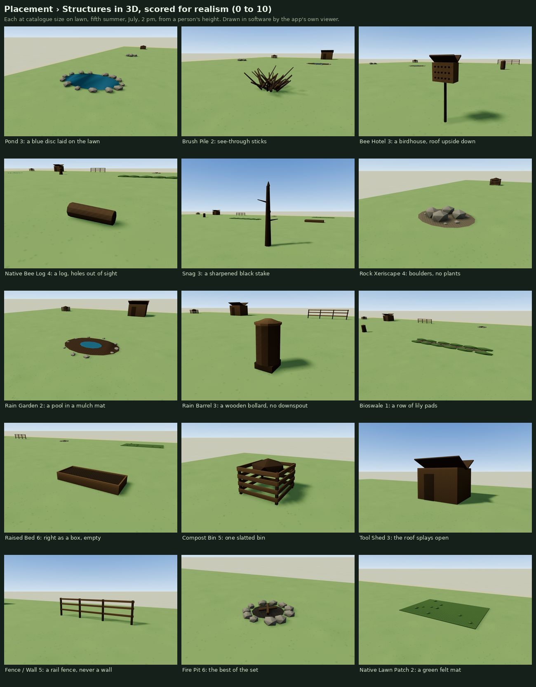
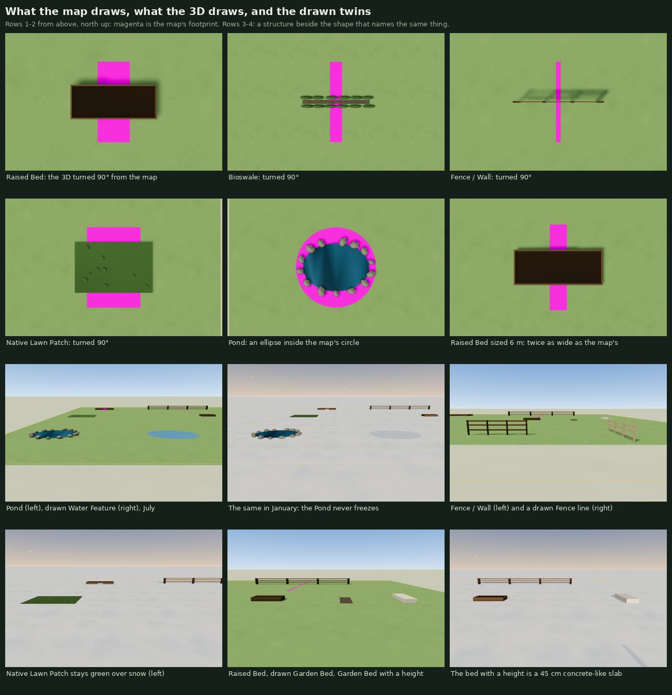
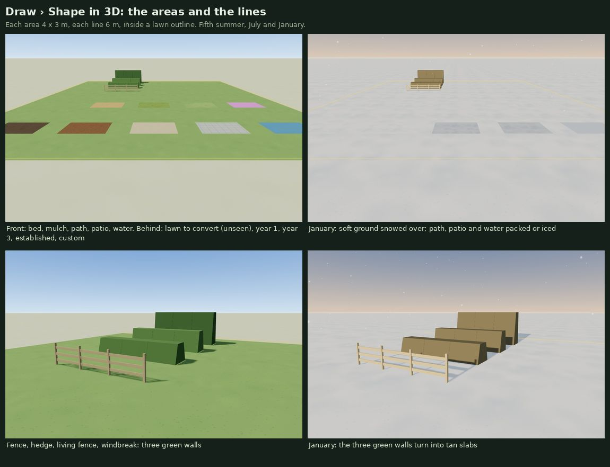

# V3.69 · The structures and the shapes, reviewed for realism (F288; feeds F280, F281)

**The owner:** "I would like a reality/realism check for the structures. Similar to the review
that was done for the plant sprites. A score out of 10 and areas for improvement. I also want
the review to extend into how 'shapes' are placed on the map and reflected on 3D. There is a
little bit of overlap between these methods of placing features that seems superfluous and
confusing. Consider the feedback recently given by the test user in this work."

The plant models have been read against photographs four times since V3.48. Nobody had looked
closely at the fifteen structures: V3.43 listed "the structure models" under *works, keep*. This
is that look. It is a review: nothing in the app changes. It adds one dev script,
`scripts/render_structures.py`, so the next increment can render before and after.

The tester's items this touches (verbatim in [`USER_FEEDBACK.md`](../USER_FEEDBACK.md), the
fourth tester): **5** (can't move a water feature or brush pile), **10** (path surfaces, doors,
spouts, mulch round the plants), **11** (water locations in the design), **12** ("some
duplicity between the features one can place and the shapes one can draw") and **17** (a raised
bed "does not appear the same way in the 3D view"). The [overview plan](V3.69-a-new-tester.md)
filed them under F279, F280 and F281 without designing them; this review is the groundwork for
F280 and F281.

## What was run

- **`scripts/render_structures.py --out DIR`** builds three test lots through the app's own
  `build_scene` and draws them with the real viewer in headless Chromium: every structure at its
  catalogue size on lawn, from a person's height (`models.jpg`); the same from above over the
  footprint the 2D map draws for it, computed exactly as `html/map/05-features.js`
  `placeStructureOnMap` draws it (`map.jpg`); and each structure beside the drawn shape that names
  the same thing, in July and January (`twins.jpg`); and every area and line kind Draw › Shape
  offers, in July and January (`shapes.jpg`). The sheets are composed in Python: with
  fifteen tiles a sheet, the probe page's own sheet step outran Chromium's virtual time and the
  page was dumped empty.
- **`scripts/render_structures.py --readers`** (no browser) puts one thing in a 12 × 12 m yard,
  placed or drawn, and prints what each part of the app makes of it: the habitat score, the
  Overview's planting area, Plan My Yard's fill zones and keep-outs, the Water page, the shade
  model, the pond planting and the 3D scene.
- **Plan My Yard** run on four of those yards (below), counting plants inside each footprint.
- Each model's builder read (`scripts/blender/assetlib/structures.py`) for its real dimensions.
- Real-world anchors from published guidance, listed under *Sources*.

The question for each score, adapted from the plant review: **would someone who has built or seen
one recognise it, and is it built the way a real one is?** A second question, which the plants
never needed, is scored for each method below: **does the 3D show what was put on the map?**

## The fifteen structures

**Mean 3.5 of 10.** That is about where the plant models stood at their first reading (3.2 in
V3.48; 5.86 after five rebuilds). Two are fair (fire pit, raised bed), three are recognisable with
a fault (compost bin, fence, bee log), and ten mislead.

| Structure | Score | What the 3D shows | What a real one is, and the fix |
|---|---|---|---|
| Fire Pit | **6** | A ring of eleven stones, ash, two crossed logs | Reads as itself. Stones are near copies; fine to leave |
| Raised Bed | **6** | A 3 × 1.2 m plank box, 40 cm walls, bare soil | Right as a box. Empty in every season, and as placed it is wrong in three ways (next section) |
| Compost Bin | **5** | One slatted 1.4 m crate, a faceted black heap in it | The description says a *3-bin system*. Either draw three bays or say one bin |
| Fence / Wall | **5** | A 5 m three-rail fence, always east-west | Reads as a fence and never as a wall. A fence is a line; as a point it can't follow a lot line (below) |
| Native Bee Habitat Log | **4** | A 1.15 m log lying on the lawn | Holes only on one cut end (9, 3 cm wide), out of sight from most views. Nesting holes are 6–10 mm, drilled into the sunny side |
| Rock Xeriscape | **4** | Four boulders and cobbles on a brown disc | Reads as a rock pile on mulch. No plants, though the description names its xeric natives |
| Pond | **3** | A blue disc 10 cm *above* the lawn inside a ring of 14 stones | A pond is dug in: water at or below ground, a shallow shelf, plants at the edge. It never freezes (the drawn Water Feature does) |
| Bee Hotel / Nest Box | **3** | A box on a pole with 15 holes 4 cm wide; **the roof is upside down** | Reads as a birdhouse. Real ones are blocks and tubes with dozens of 6–10 mm holes. The two roof boards are rotated the wrong way (`_bee_hotel`: `s * 0.6`), so they splay up like an open carton. Plan My Yard seats one in a back-yard plan, so it is in planned yards too: V3.52's review sheet shows it (`docs/3d/review_v352_yard.jpg`, *From the house*) |
| Snag | **3** | A near-black 3.5 m spike, four twig stubs, a sharpened point | Reads as a stake. The builder's own comment says "jagged broken top"; it draws a cone. Scales its height with the Size box (2 m gives a 7 m snag) |
| Rain Barrel | **3** | A dark wooden octagon 76 cm across and 1.3 m tall on a block | Reads as a bollard. A 208 L drum is about 57 × 88 cm; this one holds about 410 L, against the description's 200–300. No downspout, which is what makes it a rain barrel |
| Tool Shed | **3** | A brown box; **the roof is upside down** | Same sign error as the bee hotel (`_shed`: `s * 0.42`): a V where a gable should be. Casts a shadow in 3D and none on the shade map |
| Brush Pile | **2** | Thirty sticks radiating from a point, see-through | Guidance: a log base, larger branches over it, fine brush on top, a mound you can't see through, 1.5 m or more tall |
| Rain Garden | **2** | A mulch mat 4 cm *up*, a blue pool in the middle, stones round it on the lawn | A rain garden is a planted dip that holds water only after rain: EPCOR asks that it drain within 48 hours. The pool states the opposite, and there are no plants, which are the point of one |
| Native Lawn Patch | **2** | A dark green felt slab 6 cm thick with nine bumps | Stays green over January snow. The viewer already has a low-meadow look (`02c-site.js`, `young_meadow`) |
| Bioswale | **1** | A row of green lumps like lily pads; the "channel" is a raised gravel strip | A swale is a shallow channel *dug* along the contour. As a point object it can't be turned, so it can never follow the contour its own description asks for |

### Read again after V3.70

[V3.70](V3.70-structures-turned-to-the-map.md) fixed the roofs, the turn, the width and winter.
The same question, the same reader, from `scripts/render_structures.py`'s sheets: **mean 3.5 →
3.7.** "Matches the map" is the second question (finding 1 to 5 below), asked of the drawn model.

| Structure | V3.69 | V3.70 | Matches the map | What holds it down now |
|---|---|---|---|---|
| Fire Pit | 6 | **6** | yes (a circle) | Stones near copies; nothing to sit on |
| Raised Bed | 6 | **6** | **now yes** | Empty: Plan My Yard does not plant it (F280) |
| Fence / Wall | 5 | **6** | **now yes**, any length | Only a rail fence: never boards, chain link or a wall |
| Tool Shed | 3 | **5** | **now yes** | A plain dark box; casts no shade on the shade map (F280: a building) |
| Compost Bin | 5 | **5** | yes (a circle) | One bin where the description says three; the heap reads as a black crystal |
| Bee Hotel | 3 | **4** | **now yes** (faces east, as the map draws it) | Still a birdhouse: 15 holes 4 cm wide where nesting holes are 6–10 mm |
| Native Bee Log | 4 | **4** | **now yes** | Its holes are on one cut end, out of sight |
| Rock Xeriscape | 4 | **4** | nearly (an ellipse in the map's circle) | No plants; boulders on a mulch-coloured disc |
| Pond | 3 | **3** | nearly | Ices in winter now; still a disc laid on the lawn, no edge, no plants |
| Snag | 3 | **3** | yes | A sharpened black stake; its height grows with the Size box |
| Rain Barrel | 3 | **3** | yes | A wooden bollard about twice a real barrel's volume; no downspout |
| Brush Pile | 2 | **2** | yes | See-through sticks where a pile is a dense mound |
| Rain Garden | 2 | **2** | nearly | A pool (now iced in winter) where a rain garden drains in 48 hours; no plants |
| Native Lawn Patch | 2 | **2** | **now yes** | Snows over now; still a felt slab above the lawn |
| Bioswale | 1 | **1** | **now yes** | A row of lily pads; a swale is a channel along the contour |

Every structure now matches the map's direction and size except the three circles drawn as
ellipses. What is left is the models themselves (F288, part 2) and, for nine of the fifteen,
what F280 turns them into: a drawn area, line or building.

The shared faults, by how many structures carry them:

| Fault | Count | Structures |
|---|---|---|
| Turned 90° from the map (next section) | 7 | bee log, bee hotel, swale, lawn patch, raised bed, shed, fence |
| Raised where a real one is dug in | 4 | pond, rain garden, swale, lawn patch |
| Holds no plants where the point of it is plants | 4 | rain garden, rock xeriscape, raised bed, swale |
| Ignores the season | 4 | pond (no ice), lawn patch (no snow), raised bed and compost (bare soil in snow) |
| Size box scales the height too | 7 | every `uniform` model: a 6 m shed is 4.8 m tall |
| Wrong size against the real thing | 3 | rain barrel, bee hotel holes, brush pile |
| Upside-down roof | 2 | shed, bee hotel |

## Does the 3D show what was put on the map? Structures: 2 of 10

1. **Every rectangular structure is turned a quarter turn.** The map draws `size_m` north-south
   and `width_m` east-west (`placeStructureOnMap`); the Blender builders put the long side along x,
   east-west. A raised bed is a north-south box on the map and an east-west box in 3D. **This is
   the tester's item 17.** It is the same for the bee log, bee hotel, swale, lawn patch, shed and
   fence.
2. **The width never reaches the 3D.** `build_scene` sends `size_m` only, and the viewer scales
   the model by it in both directions (`glbStructure`). A raised bed set to 6 m in the Size box is
   6 × 1.2 m on the map and 6 × 2.4 m in 3D; a 20 m Fence / Wall is 20 m of rail with posts 36 cm
   thick, 6.4 m apart.
3. **The Size box scales height** for seven of the fifteen. It runs 0.5 to 50 m for every kind,
   in metres across; nothing asks a snag's height or a barrel's litres.
4. **Circle on the map, ellipse in 3D** for the pond, rain garden and rock pile: the 6 m pond's
   water is 5.1 × 3.7 m inside a 6 m circle.
5. **A placed structure can't be moved, turned or resized.** Right-click removes it; that is all
   (`05-features.js`: "decorative structures stay fixed"). Only existing trees and buildings drag
   and resize. **The tester's item 5** is this as much as it is F279's selection.
6. **No structure sits on a slope.** Each is set at the ground's height under its centre and never
   tilted (`buildStructures`). Read from the code; not rendered here.
7. **The shade map and the 3D disagree.** Every structure casts a shadow in the 3D and none in
   `shade.casters_from_project`, so a 2.4 m shed shades the preview and not the planting zones or
   Plan My Yard.

## One thing, two ways: what each part of the app makes of it

`render_structures.py --readers`, one thing in a 12 × 12 m (144 m²) yard:

| What is on the map | Habitat score | Overview's planting area | Plan My Yard | Water page | 3D |
|---|---|---|---|---|---|
| Pond (structure) | +2 (a type) | 144 m²: **the pond counts as ground to plant** | keeps out of a circle; pond plants seated in it | 1 pond | raised blue disc |
| Water Feature (drawn) | nothing | 125 m²: subtracted | keeps out of the shape; **no pond plants** | 0 ponds | flat blue surface, ice in winter |
| Native Lawn Patch (structure) | +2 | 144 m² | **plants over it** | | green slab |
| Lawn Area (drawn) | nothing | 120 m²: subtracted | keeps out | | lawn |
| Raised Bed (structure) | nothing | 144 m² | **plants over and around it** | | plank box, turned |
| Garden Bed (drawn) | nothing | 3.6 m²: the bed | plants in it | | bed |
| Garden Bed + 0.45 m height | nothing | 144 m²: **the bed is gone** | **a fill zone and a keep-out at once** | | a 45 cm flat-roofed building |
| Fence / Wall, or a Fence line | nothing | 144 m² | | | two fences of different colour and build |
| Tool Shed (structure) | nothing | 144 m² | **plants inside it** | | box, inverted roof |
| Rain Garden (structure) | +2 | 144 m² | **keeps out of it** | | pool in mulch |

And what Plan My Yard does with four of them (first-run goals, 70% cover, the 12 × 12 m yard):

| What is on the map | Plants | Inside its footprint |
|---|---|---|
| Garden Bed 6 × 3 m | 21 | **21** |
| The same bed with a 0.45 m height | 45 | **0**: the whole lawn is planted instead |
| Raised Bed, Size 6 m | 28 | 2 (by chance: it is not seen) |
| Tool Shed | 28 | 2 (inside the shed) |

**The Garden Bed with a height is the trap.** *Casts shade, height* sits on every area type in the
simple app. A person wanting a raised bed at their own outline would reasonably draw a Garden Bed
and give it 0.45 m. It becomes a `canopy_footprint`, which the Overview stops counting as a bed,
Plan My Yard treats as both its only fill zone and a building to keep out of, the shade map treats
as a wall, and the 3D draws as a pale slab. Item 17 has a second door, and it is worse than the
first.

So each pair is one thing to the person and two things to the app, and each half is right about
something the other gets wrong. The placed pond scores and gets pond plants, and the Overview
counts it as ground to plant; the drawn one is taken off the planting area, and scores nothing and
gets no pond plants.

## The shapes (Draw › Shape)

**Does the 3D show what was put on the map? Shapes: 7 of 10.** This is the path V3.45 built, and
it holds: every area is drawn at its own outline, laid over the terrain, in an order (a path over a
bed over the lawn), and each kind changes with the season (soft ground snows over, paths and paving
pack, water ices). A drawn area can be reshaped corner by corner after it is placed. What it loses:
the height box (the trap above), a line's look is one estimate per kind, and a line can only be
removed, never edited.

**Realism, by kind: mean 4.5 of 10.**

| Kind | Score | What the 3D shows | Fault |
|---|---|---|---|
| Garden Bed | **6** | Dark soil, its outline | Reads as a bed. A bed's edge (cut lawn, steel, stone) is not drawn |
| Mulch Area | **6** | Rust-brown chips | Reads as wood mulch. One colour for every mulch |
| Lawn Area, Lawn — to convert | **6** | The lawn | Indistinguishable from the outline's lawn, which is right: it is lawn |
| Fence (line) | **6** | Pale posts and three rails along the line | Reads as a rail fence. A board fence, chain link or a wall can't be chosen |
| Pathway | **5** | Pale beige, flat | Reads as gravel or sand. Every path is that: no stone, mulch or paving choice (item 10) |
| Patio / Deck | **5** | Grey pavers with joints | Reads as paving. A wooden deck is drawn as stone |
| Restoration Year 1, Year 3, Established native | **5** | Tan, olive, pale speckled flat textures | Flat paint; the height of a meadow comes only from plants placed in it |
| Water Feature | **4** | Flat blue paint flush with the lawn | Ices in winter (the placed Pond doesn't). No edge, no depth, no plants |
| Hedge, Living fence, Windbreak | **2** | A solid green wall with seams, 1.2, 1.6 and 3 m tall | Read as green walls, and in January as tan slabs. The species is free text, so nothing can be drawn from it; the shrubs the app now draws well (`03d-woody.js`) could make a hedge if it were a row of a chosen native shrub (question 4) |
| Custom | n/a | The person's colour | As intended |

## What the tester's items come to

| Item | What this review found |
|---|---|
| 17, raised bed in 3D | Two causes: the quarter turn (finding 1) and the width (finding 2). And the drawn workaround (a bed with a height) is a building |
| 12, duplicity | Four pairs (pond, fence, lawn, bed), plus a shed beside drawn buildings. Each pair answers differently in every reader above |
| 5, moving a water feature or brush pile | A structure can't be moved at all, selected or not |
| 10, path surfaces, doors, spouts, mulch | One *Pathway* look for every material; no door or downspout anywhere; mulch only as a drawn area |
| 11, water | A rain garden is kept out of and never planted; a drawn Water Feature gets no pond plants and counts as no pond |

## Directions

The order matters because F280 will turn some structures into drawn kinds, and a model fixed now
would be thrown away then. **Fix what survives the merge; build the rest once, from its outline.**

### Now, small, no decision needed (F288, part 1)

- **The roofs the right way up** on the shed and the bee hotel: the sign of one rotation each in
  `structures.py`, and two models rebuilt.
- **The 3D turned to match the map.** The map is what the person placed it on, so the model turns
  to match it, and an old design then looks in 3D as it always did on the map. A `bearing` on each
  structure (default: the map's north-south) is the start of turning one (below).
- **The width sent and used**, and the height left alone when only the footprint grows. The Size
  box limited per kind.
- **Winter for the pond and the lawn patch**, by `seasonSnow` as the drawn surfaces already do.

These four end item 17's first cause and make the twins sheet honest while F280 is planned.

### The objects that stay objects (F288, part 2, after F280's shape is settled)

Bee hotel (blocks and tubes, 6–10 mm holes, facing south-east), bee log (holes on its sunny side),
snag (broken top, thicker, lighter wood, height in metres), brush pile (built by rule from its
size: logs, then branches, then brush, a mound you can't see through; P1), rain barrel (a 208 L
drum on blocks, under a downspout once F281 has them), compost bin (three bays, or one bin said
plainly), fire pit (as it is). Each placed, then **moved and turned** (R, as the communities turn,
`11b-turn.js`), and sized in its own terms. Read each against photographs, as the plants were.

### F280: one palette, three verbs

Every item answers *draw an area*, *draw a line* or *place an object*, grouped as RM-9 groups them
(for wildlife, for water, around the yard):

| Today | Becomes | Then in 3D |
|---|---|---|
| Pond + Water Feature | **Pond**, an area | water at ground level from its outline, a shelf, ice in winter; pond plants seated in it; it scores and counts on the Water page |
| Rain Garden | **Rain garden**, an area, planted (F281) | a shallow dip with plants, no pool |
| Bioswale | **Swale**, a line with a width, along the contour | a shallow channel draped on the ground |
| Native Lawn Patch + Lawn Area | **Lawn**, an area: *regular* or *native, low-mow* | lawn, or the low-meadow look |
| Raised Bed + Garden Bed (and its height trap) | **Bed**, an area: *at ground* or *raised, N cm* | a frame along the outline at its height; a fill zone either way |
| Rock Xeriscape | **Rock garden**, an area, planted with dry-ground natives | boulders scattered by rule inside the outline |
| Fence / Wall + Fence line | **Fence or wall**, a line: rail, board or wall | posts and rails, boards, or a wall, along the line |
| Tool Shed | **Building**, an area with a height | gable by `scene_site.roof_for`; casts shade on the map too |
| Pathway | **Path**, with a surface: stone, gravel, mulch, paving | a look per surface |
| Bee hotel, bee log, snag, brush pile, compost, barrel, fire pit | **Objects** | as above |
| (new) Downspout, door | **Objects on a building's wall** (F281) | |
| (new) Mulch round each plant | **A plan option** | a ring on the ground |

*Casts shade, height* then leaves the area form, except for Building and Tree canopy. Old designs
convert on open to the drawn kind **at the outline the map showed**, so nothing moves on anyone's
map; a file-format step and a test. `cues_to_care` reads the Native Lawn Patch and Fence structures
as cues to care (P13): the merge carries them.

### F281: water

The Rain Garden and Pond rows above are F281's ground: a rain garden planted (it is a keep-out
today), a drawn pond seated with pond plants, downspouts as objects. Its own plan.

## Questions for the owner, with a recommendation

1. **One palette, three verbs** (draw an area, draw a line, place an object), with Structures as
   its groups? *Recommended.* This is F280's open question. **Answered yes** (the owner, after
   this review).
2. **Old designs convert to what the map showed** (a north-south raised bed stays north-south, its
   3D turns to match)? *Recommended*: the map is what the person saw when they placed it.
   **Answered yes**, and the 3D turned to the map in [V3.70](V3.70-structures-turned-to-the-map.md)
   with the other three small fixes (F288, part 1).
3. **A shed becomes a building** (drawn, casts shade, gable roof), the same as a scanned one?
   *Recommended.* **Answered yes**; planned in [V3.71](V3.71-one-palette.md).
4. **A hedge as real plants.** Today a hedge's species is free text and its "~N plants" exist
   nowhere else: not bought, not scored, drawn as one green mass. A hedge as a row of a chosen
   native shrub (the Row pattern exists) would be counted everywhere. *Recommended, with F280.*
   **Answered yes**; planned in [V3.71](V3.71-one-palette.md).
5. **The habitat score's structure points.** A rain barrel scores the same 2 points as a brush
   pile, and a placed Native Lawn Patch scores while a drawn native meadow does not. F256 already
   plans points by habitat value (its D3); this review adds the drawn kinds to that question.

## Sources

Real-world anchors, read through search summaries (the pages themselves were not opened from this
session; check before quoting a number further):

- Nest hole sizes: [Utah State University Extension, *Making and Managing Wild Bee Hotels*](https://extension.usu.edu/pests/research/making-and-managing-wild-bee-hotels)
  (mason bees about 6–10 mm, leafcutters smaller; tubes 3–6 inches deep);
  [NC State Extension, *Bee hotel design and placement*](https://content.ces.ncsu.edu/publication/bee-hotel-design-and-placement).
- Rain garden drain time: [EPCOR, low impact development](https://www.epcor.com/products-services/drainage/flood-mitigation/Pages/low-impact-development.aspx)
  (drain within 48 hours); [City of Calgary, rain gardens](https://www.calgary.ca/water/projects/rain-garden-calgary.html)
  (standing water no more than 48 hours).
- Brush piles: [Connecticut DEEP, *Brush Piles for Wildlife*](https://portal.ct.gov/DEEP/Wildlife/Fact-Sheets/Brush-Piles-for-Wildlife)
  (log base, larger branches then smaller, not see-through);
  [Maryland DNR, *Creating a Wild Backyard: Brush Piles*](https://dnr.maryland.gov/wildlife/pages/habitat/wabrush.aspx)
  (a mound about five feet tall).
- Drum size: [Container Exchanger, *55 gallon drum dimensions*](https://blog.containerexchanger.com/55-gallon-drum-dimensions/)
  (208 L, about 57 cm across and 85–90 cm tall; a trade blog, the weakest of these).

## What could not be checked

- **On a slope**: finding 6 is read from the code; no sloped lot was rendered.
- **On a graphics card**: the pictures are drawn in software, which changes light and edges, not
  shapes or sizes.
- **Where Plan My Yard seats the structures it adds** (a brush pile, a bee hotel; Y5) was not
  reviewed, only that they inherit findings 1 to 7.
- **The walk**: the walker passes through structures (only buildings stop it, `ringNearest`);
  read from the code.
- The scores are one reader's, as the plant scores were. Re-read after the fixes with the same
  script.

## What was deliberately not done

No model, viewer or placement code changed. The cheap fixes (the roofs, the turn) are listed and
not made: the owner asked for a review, and the turn interacts with question 2.
