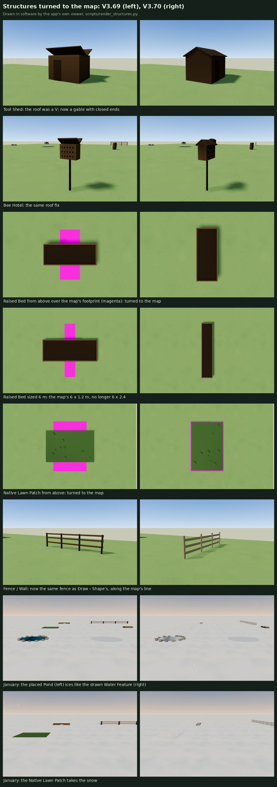

# V3.70 · Structures turned to the map (F288, part 1)

**The owner**, answering [the V3.69 review](V3.69-structures-and-shapes-reviewed.md): "yes to
both, go ahead with the four small fixes." *Both* are the review's first two questions:
Structures become groups inside one palette of three verbs (F280, to be planned), and **old
designs keep the orientation the map showed**. The four small fixes were the review's *Now,
small, no decision needed* list: the roofs, the turn, the width, winter.

This is the first cause of the tester's item 17 ("When raised bed feature is placed it does not
appear the same way in the 3D view", `docs/USER_FEEDBACK.md`, the fourth tester), fixed, and the
models' plainest faults with it. It does not merge structures and shapes (F280), plant a rain
garden (F281) or rebuild the misleading models (F288, part 2).

## What changed

**1. The roofs.** The shed's and the bee hotel's two roof boards were tilted with their outer
edges up (`Matrix.Rotation(s * pitch)`), so each roof was a V. One helper, `_roof_tilt`, tilts
them the right way, and a closed gable (`_gable`, a triangular prism) fills the triangle under
each ridge, which the corrected roof would otherwise leave open at both ends. The bee hotel's
roof drops 4 cm so its eaves rest on the box. Both models rebuilt with Blender 4.2 (below).
Shed: ridge 2.46 m, eaves 1.86 m; bee hotel: 1.54 m and 1.40 m (both were the other way up).

**2. The turn.** The map draws a rectangle's `size_m` north-south and its `width_m` east-west
(`placeStructureOnMap`); the models are authored with the long side east-west. A new Qt-free
module, `src/scene_structures.py`, decides each structure's scene entry and gives a rectangle the
**bearing of its long side**, read as the map reads the stored definition (no `shape` is a
rectangle there, no width a square). It is always north today (`MAP_BEARING_DEG`), because
nothing turns a placed structure yet; when part 2 adds turning, the bearing is stored on the
feature and the map and this module both read it. The viewer turns the model to it
(`glbStructure`, `09-models.js`). The pond, rain garden and rock pile are circles on the map and
are left as they were. **Following the owner's answer to question 2, the 3D turned to match the
map**, so an old design looks in 3D the way it always looked on the map. One consequence: the bee
hotel's face, which looked south before, now looks east (its long side runs north-south on the
map), and the shed's door is on its east side.

**3. The width, and what the Size box means.**
- The scene sends a rectangle's `width_m`, the manifest says each model's authored width (from
  `STRUCTURE_WIDTHS` in the builder), and the viewer scales the long side by `size_m` and the
  short side by `width_m`. A raised bed sized 6 m is 6 × 1.2 m in both views; it was 6 × 2.4 in 3D.
- A **Fence / Wall** is now drawn as a fence line (`scene_structures.fence_lines`): posts and rails
  along the map's rectangle, the same fence as Draw › Shape's. Its stock model was 5 m of rail
  whose posts stretched with the Size box (a 20 m fence had 36 cm posts 6.4 m apart), and it looked
  nothing like the drawn fence beside it.
- The **shed** scales as a footprint: a bigger shed is longer and wider, not taller (a 6 m shed
  had been drawn 4.8 m tall).
- The **Size box** has a range per kind (`structures.size_range`, stated as estimates in the
  module: a bee hotel 0.2–1.2 m, a raised bed 1–8 m, a pond 1.5–12 m…); it ran 0.5–50 m for
  everything, and a 50 m bee hotel was drawn 133 m tall. Its label says what it measures: *Length*
  for a rectangle (the width stays the catalogue's, as the map draws it), *Across* otherwise.
  The ranges are kept out of the stored definitions, so no saved file changes shape.

**4. Winter.** In a snow month a structure's water ices and its soft or flat parts (turf, soil,
mulch, the compost heap, ash, gravel, roofs) take the snow, by the part names the builders give
(`structureWinter`, `05-flowers.js`). Ice is the drawn Water Feature's colour and roughness. The
models have no texture coordinates, so it is colour, not the ground's snow painting. The pond had
stayed open blue water through January and the lawn patch green.

## How it was checked

- **`tests/test_structure_scene.py`** (13): the catalogue, the manifest and the builder agree on
  each model's authored size and width; a rectangle's scene entry carries the map's width and
  bearing, a definition with no shape is read as the map reads it, a fence is a north-south line of
  its length; every kind's range holds its default; both roofs are gables, read off the shipped GLB
  files with the standard library; and **in the real viewer** (headless Chromium) a 6 m raised bed
  measures 6.0 m north-south by 1.2 m east-west, the bee log and the shed lie north-south, and
  January ices the pond and snows on the lawn patch. **The three viewer checks fail on V3.69's
  viewer** (the bed measured 2.4 m north-south there), checked by putting its two files back.
- **`tests/test_structures_grouped.py`** (+2): the Size box's words and range follow the chosen
  structure, and Place hands over a size held to the range.
- `scripts/render_structures.py` before and after (the picture above).
- **The whole suite** (`scripts/run_tests.py`, PyQt6 present, no WebEngine): 6,267 ran, 8 failed,
  and all 8 fail the same way on V3.69 in this container: six need PyQt6-WebEngine, two needed
  `shapely` and pass once it is installed.

## Rebuilding the two models

`bpy==4.2.*` installs into a Python 3.11 virtual environment in a session (`python3.11 -m venv`,
then `pip install "bpy==4.2.*"`), and `assetlib.build_all(out_dir=…, only=[...])` builds a subset
to a scratch folder with no manifest. Rebuilt **unchanged** first: the geometry matched the shipped
files vertex for vertex and only the baked shading differed, which is the repo's known "does not
rebuild byte for byte". Then the fixed builder, and the two files copied in. The manifest's
structure entries were written by the builder's own `manifest_dict()` (width added, the shed's
scale mode), so a full rebuild writes the same.

## Left alone, on purpose

- **The pond, rain garden and rock pile are still ellipses inside the map's circle** (the review's
  finding 4): the pond's water constants are shared with `pond_habit` and its planting, and the
  pond becomes a drawn area in F280.
- **No structure can yet be moved, turned or resized after placing** (finding 5): part 2, with F279.
- **Slope**: a structure is still set at the ground's height under its centre (finding 6).
- **The shade map still ignores structures** (finding 7), so a shed shades the 3D and not the
  planting zones. It becomes a building in F280 (the owner's question 3, unanswered).
- The models' other faults (the brush pile, rain garden, swale, rain barrel, snag, lawn patch's
  slab): part 2, after F280's shape is settled, so nothing is built twice.

## What could not be checked

- On a graphics card or a real desktop: the viewer checks run in software in headless Chromium.
- The Size box on the owner's machine: its widget test runs offscreen.
- Whether an east-facing bee hotel suits the region's bees better or worse than a south-facing
  one: the face follows the map, as the owner chose, and part 2 lets a person turn it.
